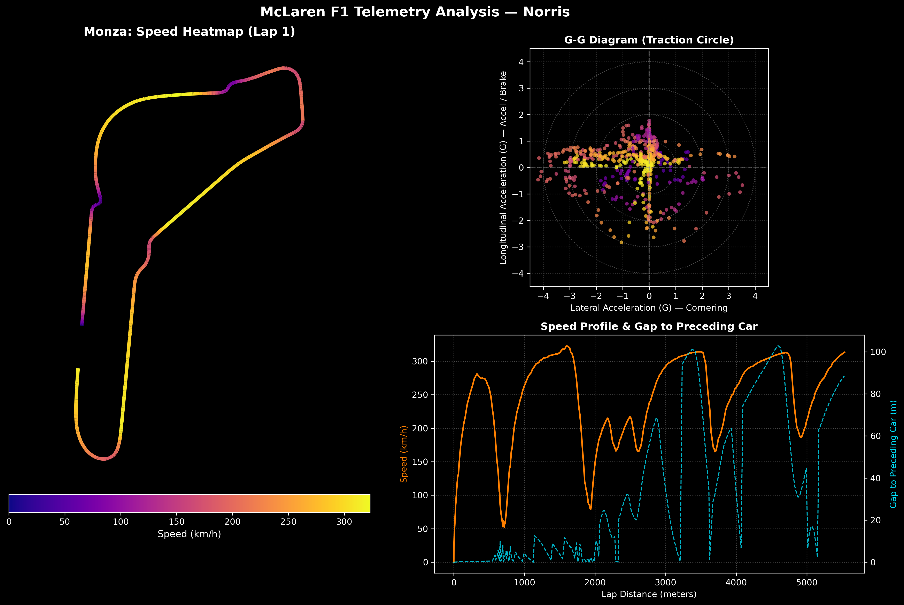

# F1 Lap Telemetry & Dynamics Analysis: Monza

An engineering telemetry analysis tool built in Python using high-frequency vehicle dynamics data from Formula 1 (McLaren Racing / Lando Norris).



## Overview
This project processes raw, multi-dimensional sensor data recorded during a racing lap at Autodromo Nazionale Monza. It calculates physical vehicle parameters (lateral and longitudinal G-forces), reconstructs the track layout, and visualizes driver telemetry.

## Key Features
- **2D Track Reconstruction:** Renders the Monza circuit geometry using spatial coordinates $(X, Y)$ with speed-based colormapping (`LineCollection`).
- **G-G Diagram (Traction Circle):** Evaluates tire grip limits and braking performance by translating 2-axis acceleration vectors ($m/s^2$) into normalized Gravitational forces ($G$).
- **Traffic & Delta Correlation:** Compares vehicle throttle, braking, and top-end speed against distance gaps to preceding cars (`DistanceToDriverAhead`).

## Tech Stack
- **Python 3.x**
- **Pandas** — data manipulation and extraction
- **NumPy** — vector mathematics and signal processing
- **Matplotlib** — multi-panel visualization with custom layouts (`GridSpec`)

## Getting Started

1. Clone the repository:
   ```bash
   git clone [https://github.com/YOUR_USERNAME/f1-telemetry-analysis.git](https://github.com/YOUR_USERNAME/f1-telemetry-analysis.git)
   cd f1-telemetry-analysis

   Install dependencies: pip install -r requirements.txt
   Launch Jupyter Notebook: jupyter notebook f1_monza_analysis.ipynb
   
